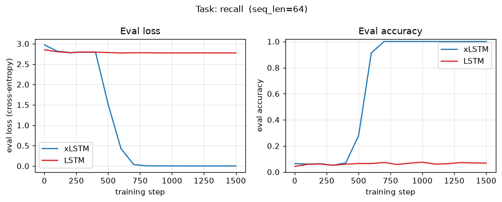
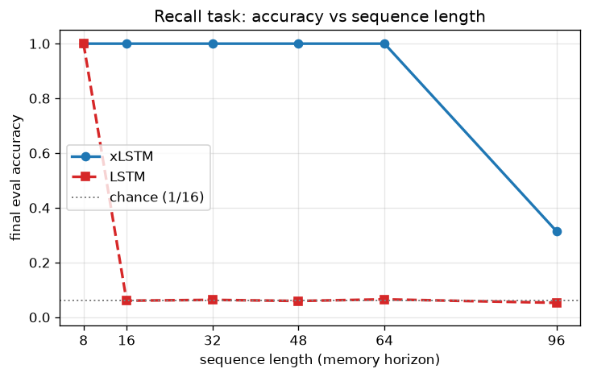

# xLSTM from scratch — details

Longer material moved out of the main [README](../README.md). Nothing here is new; it is the old README's tables, diagram, notes and commands, lightly edited. The math derivation lives in [NOTES.md](../NOTES.md).

Paper: Beck, Pöppel, Spanring, Auer, Prudnikova, Kopp, Klambauer, Brandstetter, Hochreiter. *"xLSTM: Extended Long Short-Term Memory."* NeurIPS 2024. [arXiv:2405.04517](https://arxiv.org/abs/2405.04517).

Scope: this is an independent educational / portfolio re-implementation. It is **not** the authors' official code and **not** novel research. The goal is a correct, readable, well-tested re-derivation of the core mechanics.

---

## 1. Headline result (64-token recall)

Task: "remember the first token" over a 64-step sequence, vocabulary 16, so chance = 1/16 ≈ 6.25%. The from-scratch xLSTM reaches 100% accuracy in about 2 minutes on CPU. A vanilla LSTM trained identically never beats chance.



### 1.1 Recorded rows (source: `assets/metrics.json`)

| Model                               | Params  | Final eval accuracy | Final eval loss |
|-------------------------------------|--------:|:-------------------:|:---------------:|
| **xLSTM** (2 blocks: mLSTM + sLSTM) | 124,872 | **100.0%**          | **0.0018**      |
| LSTM (d=64, 2 layers)               |  68,736 | 6.8%                | 2.7729          |

Same task, optimizer (AdamW, lr 3e-3, cosine), batch size 64, 1500 steps, seed 0, CPU. These two rows are the real outputs of `scripts/train_demo.py`; reproduce them with the command in section 5. Wall-clock in the JSON: xLSTM 116.1 s, LSTM 35.6 s.

### 1.2 Larger-LSTM rows (not recorded in any committed file)

The old README also listed three bigger LSTM baselines and claimed the LSTM stays at chance "even with up to 2x more parameters":

| Model                   | Params  | Final eval accuracy |
|-------------------------|--------:|:-------------------:|
| LSTM (d=64, 3 layers)   | 102,016 | 6.2%                |
| LSTM (d=96, 2 layers)   | 152,256 | 7.0%                |
| LSTM (d=128, 2 layers)  | 268,544 | 6.5%                |

Status of this evidence:

- The parameter counts match `xlstm/lstm_baseline.py` for those configs, so the configurations are real.
- The accuracies are **not saved** in any committed file. `assets/metrics.json` holds only the two rows in 1.1.
- The headline reproduce command runs d=64 / 2 blocks only. `--embedding-dim` and `--num-blocks` resize both models, and every run overwrites `assets/metrics.json`.
- Treat the three accuracies as unverified until per-config JSONs are committed. Suggested commands (not yet run and committed):

```bash
python scripts/train_demo.py --task recall --seq-len 64 --vocab-size 16 --steps 1500 --embedding-dim 96  --metrics-json assets/metrics_d96.json
python scripts/train_demo.py --task recall --seq-len 64 --vocab-size 16 --steps 1500 --embedding-dim 128 --metrics-json assets/metrics_d128.json
python scripts/train_demo.py --task recall --seq-len 64 --vocab-size 16 --steps 1500 --num-blocks 3      --metrics-json assets/metrics_3blocks.json
```

Note: these commands resize the xLSTM in the same run, so each JSON will hold a different xLSTM too.

### 1.3 Interpretation

The LSTM result is consistent with the long-horizon credit-assignment problem that xLSTM's exponential gating is designed to address. No gradient-norm measurement is recorded in the repo, so this is an interpretation, not a measured cause.

---

## 2. Scaling experiment — where the LSTM collapses

`scripts/recall_sweep.py` re-runs the same recall task across sequence lengths. It records the final eval accuracy of a fresh xLSTM and a fresh LSTM at each length. Same optimizer, schedule and seed; a deliberately small 1100-step budget so the whole sweep finishes in about 6.7 minutes on CPU (401 s in the JSON).



| Sequence length | xLSTM accuracy | LSTM accuracy |
|----------------:|:--------------:|:-------------:|
|   8             | **100.0%**     | 100.0%        |
|  16             | **100.0%**     | 6.1%          |
|  32             | **100.0%**     | 6.3%          |
|  48             | **100.0%**     | 6.0%          |
|  64             | **100.0%**     | 6.5%          |
|  96             | 31.4%          | 5.3%          |

Recall task, vocabulary 16 so chance ≈ 6.25%; AdamW lr 3e-3 cosine, batch 64, 1100 steps, seed 0, CPU, embedding dim 64, 2 blocks, 4 heads. Real outputs of `scripts/recall_sweep.py`; raw numbers in `assets/recall_sweep.json`.

**What it shows.** The LSTM solves the trivial 8-step recall, then sits on the 1/16 chance line from length 16 onward. The xLSTM holds 100% out to 64 tokens, an 8x longer horizon than where the LSTM breaks.

### 2.1 Length 96: what is recorded and what is not

Recorded: within the 1100-step budget the xLSTM reached 31.4% at 96 tokens (`assets/recall_sweep.json`).

Not recorded in any committed file (console observations from the owner's run; `scripts/recall_sweep.py` only prints the per-step curve to stdout):

- The eval accuracy at length 96 was still climbing at the budget cap: about 0.06 → 0.10 → 0.28 → 0.31 over the final ~500 steps.
- The recall task appears to be learned in a late, sharp phase transition ("grokking") whose onset moves later as the horizon grows: around step ~200 at length 16, ~600 at length 64, and only starting around step ~800 at length 96.

Not tested: whether a larger `--steps` budget lets the xLSTM reach 100% at length 96. The old README predicted this; no run with `--steps 1600` is committed. The command to test it is in section 5.

---

## 3. Architecture

The model is a stack of pre-norm residual blocks over a shared residual stream of width `d`:

```
tokens ─► Embedding ─►┌──────────────── xLSTM block ───────────────┐─► … ─► LayerNorm ─► Linear head ─► logits
                      │  x ─► LayerNorm ─► (causal conv) ─► CELL ─► │
                      │       GroupNorm ─► gate / projection ─►(+x) │   (mLSTM and sLSTM blocks alternate)
                      └─────────────────────────────────────────────┘
```

- **mLSTM block** ("pre up-projection"): `LayerNorm → up-project → causal conv + SiLU → mLSTM (matrix memory) → GroupNorm → output gate → down-project → +residual`.
- **sLSTM block** ("post up-projection"): `LayerNorm → causal conv + SiLU → sLSTM (scalar memory) → GroupNorm → gated feed-forward → +residual`.

### 3.1 The two cells

| | **sLSTM** (`xlstm/slstm.py`) | **mLSTM** (`xlstm/mlstm.py`) |
|---|---|---|
| Memory | scalar cell `c_t` per unit | **matrix** `C_t ∈ ℝ^{d×d}` per head |
| Update | gated add `f·c + i·z` | outer product `f·C + i·(v kᵀ)` (fast weights) |
| Gates | **exp** input (+ stabilizer) | **exp** input (+ stabilizer) |
| Recurrence on `h_{t-1}` | yes, block-diagonal per head | **none** → parallelizable |
| Read-out | `o·c_t / n_t` | `C_t q_t / (n_tᵀ q_t)` (linear attention) |

### 3.2 Exponential gating and the stabilizer

`exp(ĩ_t)` is unbounded and overflows `float32` (`exp(89) = inf`). xLSTM adds a stabilizer state `m_t` (a running max in log-space) and a normalizer state `n_t`. The read-out `c_t / n_t` is invariant to a common rescale, so both are divided by `exp(m_t)` to keep everything `O(1)`. The stabilized gates `i'_t` and `f'_t` lie in (0, 1]. The full equations for both cells, and the parallel form, are in [NOTES.md](../NOTES.md) (kept in one place to avoid drift).

For the mLSTM, `c_t` becomes the matrix `C_t` updated by `v_t k_tᵀ`, and the read-out is a query against it. The mLSTM also has an exact parallel (linear-attention) form. `tests/test_mlstm.py::test_parallel_matches_recurrent` checks it against the O(L) recurrence with `torch.allclose(atol=1e-5, rtol=1e-4)`. An earlier README said "< 1e-6"; the test does not enforce that tolerance.

---

## 4. Tests and CI

```bash
pytest -q          # 35 fast CPU tests
ruff check .       # lint
```

The tests cover:

- shape correctness for sLSTM / mLSTM / blocks / model, and the matrix-memory update shapes;
- numerical stability of exponential gating under huge inputs: inputs scaled by 10x, 100x and 1000x, with both sigmoid and exponential forget gates, must give finite outputs and states (`tests/test_stability.py`);
- finite gradients through both cells at inputs scaled by 100x;
- parallel-vs-recurrent mLSTM equivalence (tolerance above);
- causality of the manual causal conv;
- an overfit-one-batch test showing the blocks drive loss to about 0.

CI (`.github/workflows/ci.yml`) runs `ruff check .` and `pytest -q` on Python 3.10, 3.11 and 3.12 with CPU-only torch.

---

## 5. Reproduce commands

```bash
# Headline figure + table (xLSTM vs LSTM on 64-step recall). Writes assets/training_curves.png and assets/metrics.json.
python scripts/train_demo.py --task recall --seq-len 64 --vocab-size 16 --steps 1500

# Regenerate assets/recall_sweep.png + assets/recall_sweep.json (~6.7 min, CPU).
python scripts/recall_sweep.py

# Cheaper / longer variants:
python scripts/recall_sweep.py --seq-lens 8 16 32 64 --steps 800   # ~2 min
python scripts/recall_sweep.py --seq-lens 96 --steps 1600          # untested: does length 96 reach 100%?
```

Other tasks (`--task parity`, `--task majority`) and sizes are available; see `python scripts/train_demo.py --help`. The shorter `--seq-len 32` variant is solved by the xLSTM in about 30 s.

Setup: Python 3.10 or newer, CPU only is fine.

```bash
python3 -m venv .venv
source .venv/bin/activate          # Windows: .venv\Scripts\activate
pip install -r requirements.txt
```

---

## 6. Project structure

```
xLSTM/
├── xlstm/
│   ├── config.py          # dataclass configs (cell / block / model)
│   ├── slstm.py           # sLSTM cell: scalar memory, exp gating, stabilizer
│   ├── mlstm.py           # mLSTM cell: matrix memory, recurrent + parallel forms
│   ├── blocks.py          # CausalConv1d, mLSTM/sLSTM pre-norm residual blocks
│   ├── model.py           # stacked xLSTM model + param counting
│   ├── lstm_baseline.py   # vanilla nn.LSTM baseline (same I/O contract)
│   └── data.py            # synthetic long-range tasks (recall / parity / majority)
├── scripts/
│   ├── train_demo.py      # train xLSTM + LSTM at one horizon, save curves & metrics
│   └── recall_sweep.py    # accuracy-vs-length scaling sweep (xLSTM vs LSTM)
├── tests/                 # pytest suite (shapes, stability, equivalence, overfit)
├── assets/                # committed training_curves.png + recall_sweep.png + *.json
├── docs/DETAILS.md        # this file
├── NOTES.md               # the gating/stabilizer math, sLSTM vs mLSTM vs LSTM
├── requirements.txt       # pinned deps
├── pyproject.toml         # packaging + ruff + pytest config
└── .github/workflows/ci.yml  # lint (ruff) + tests (pytest) on 3.10–3.12
```

---

## 7. Implementation notes / deviations from the paper

The re-implementation is faithful to the gating + stabilizer mathematics but is deliberately simplified for clarity and CPU-scale demos:

1. **Stabilized read-out floor.** The denominators use `max(|n|, exp(-m))` floored by a tiny `1e-6`. The `exp(-m)` term is the paper's "1 in the un-stabilized domain". The extra `1e-6` only prevents a `0/0` when *both* `|n|` and `exp(-m)` underflow under extreme inputs (for example a huge exponential forget gate). It is a no-op in normal regimes.
2. **mLSTM heads** share a single `head_dim` for queries, keys and values. The parallel form is the plain `O(L²)` linear-attention version rather than the paper's `O(L)` chunked-parallel kernel. The `O(L)` recurrence is the reference; the parallel form is tested to match it numerically (tolerance in section 3.2).
3. **Causal conv** is a manual depthwise shift-and-accumulate instead of a grouped `nn.Conv1d`. The grouped-conv backward is very slow on CPU (about 10x the rest of the model). The two are mathematically identical, and causality is unit-tested.
4. **Blocks** keep the essential pre-norm / projection / conv / GroupNorm / gate structure of the paper's blocks. They are not an exact match of every projection ratio and initialization.
5. **Scale.** Everything is sized for a from-scratch CPU demo (about 125k params), not the paper's large-scale language-modelling experiments.

None of these change the exponential-gating / stabilizer derivation in [NOTES.md](../NOTES.md).

---

## 8. References

- Beck et al., *xLSTM: Extended Long Short-Term Memory*, NeurIPS 2024 — [arXiv:2405.04517](https://arxiv.org/abs/2405.04517)
- Hochreiter & Schmidhuber, *Long Short-Term Memory*, Neural Computation 1997
- Official xLSTM code (for reference, not used here): <https://github.com/NX-AI/xlstm>

## License

MIT — see [LICENSE](../LICENSE). This is an educational re-implementation; the xLSTM architecture is due to Beck et al.

— Jun Hur
